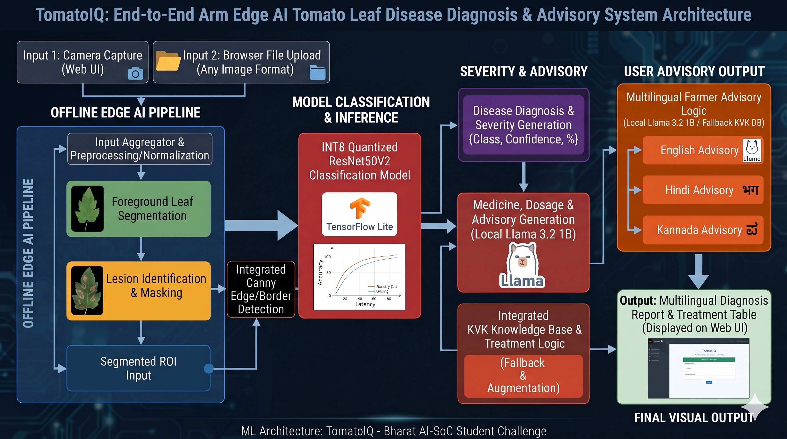

# TomatoIQ — Offline Arm Tomato Leaf Disease Detection & Farmer Advisory

**Bharat AI-SoC Student Challenge Submission**  
**GitHub Profile:** [github.com/sahilatr](https://github.com/sahilatr)  
**Team:** [Sahil Sexsena](https://github.com/sahilatr), Varalakshmi S Kulal, Sowmyarani  
**Target Hardware:** Raspberry Pi 5 (Linux / aarch64) & Arm Edge Devices (benchmarked on Apple M2 MacBook Air)  
**Deployment Mode:** 100% Offline (0 KB External Cloud Inference Payload)

---

## Overview

**TomatoIQ** is an offline-first edge AI diagnostic and agronomic advisory system built for tomato growers in low- or no-connectivity regions. Running completely locally on Arm hardware, it combines foreground leaf/lesion isolation, INT8 quantized ResNet50 disease classification, severity estimation, verified KVK treatment lookup, and on-device **Llama 3.2 (1B Instruct)** multilingual guidance (English, Hindi, and Kannada) with offline voice output.

* **99.01% Validation Accuracy** (1,895 / 1,914 images; Macro F1: `0.9899`) across 4 classes: **Early Blight**, **Late Blight**, **Yellow Leaf Curl Virus (TYLCV)**, and **Healthy**.
* **Fast Edge Inference:** `18.54 ms` mean ResNet50 INT8 inference latency (`53.94 FPS`) and `245.16 ms` end-to-end vision pipeline latency (`4.08 FPS`).
* **Zero Cloud Dependency:** Segmentation (`u2netp`), vision classification (`INT8 TFLite` / `ExecuTorch`), treatment retrieval, and Llama 3.2 advisory run locally on-device.

---

## System & ML Architecture



### End-to-End Pipeline Flow
1. **Input Acquisition & Web Routing (`POST /analyze`):** Accepts live webcam/CSI camera captures (`cv2.VideoCapture`) or browser image uploads via the local Flask Web UI (`index.html`).
2. **Leaf & Lesion Preprocessing (`extract_main_leaf_from_camera` & `isolate_leaf_and_lesions`):** Uses `rembg` (`u2netp` on ONNX Runtime) with OpenCV color-space filtering, morphological cleanup, and border/contour extraction to isolate the primary leaf (`working_rgb`) and lesion masks.
3. **On-Device Vision Classification (`run_vision_inference`):** Runs the INT8 quantized ResNet50 model (`models/tomato_resnet50_int8.tflite` with XNNPACK CPU delegate, alongside primary ExecuTorch `.pte` support) to predict disease class, confidence score, and lesion severity percentage.
4. **Curability & Verified KVK Treatment Retrieval (`estimate_curability` & `retrieve_verified_treatment`):** Maps the detected condition and 10%-bracket severity score against verified KVK agronomic protocols for medicine and dosage baselines.
5. **Local Llama 3.2 Advisory & Guardrails:** Locally hosted **Llama 3.2 (1B Instruct)** (`models/hf_llama3_2`) generates farmer-friendly medicine, dosage, and preventive advisories, sanitized via `clean_llama_meta_phrases`, `validate_llama_explanation`, and `translate_farmer_style`.
6. **Multilingual Web UI, Follow-Up Chat & Offline Voice:** Displays diagnosis and treatment tables in **English, Hindi, and Kannada**, supports follow-up chat (`/chat`), scan history (`/history`), printable summaries (`/report`), and offline audio advisories (`/generate_voice`).

---

## Dataset & Evaluation Results

Evaluated on **1,914 validation images** (from a 9,573-image dataset split 80/20):

| Class | Train Samples | Validation Samples | Precision | Recall | F1-Score |
| :--- | :---: | :---: | :---: | :---: | :---: |
| **Early Blight** | 1,920 | 480 | 0.9936 | 0.9771 | 0.9853 |
| **Late Blight** | 1,851 | 463 | 0.9764 | 0.9827 | 0.9795 |
| **Yellow Leaf Curl** | 1,962 | 490 | 0.9959 | 1.0000 | 0.9980 |
| **Healthy** | 1,926 | 481 | 0.9938 | 1.0000 | 0.9969 |
| **Total / Macro Avg** | **7,659** | **1,914** | **0.9899** | **0.9900** | **0.9899** |

---

## Hardware Profiling & Optimization Techniques

### Stage-Wise Latency Benchmark (Apple M2 MacBook Air, macOS)
| Pipeline Stage | Mean (ms) | p50 (ms) | p95 (ms) | p99 (ms) | Throughput |
| :--- | :---: | :---: | :---: | :---: | :---: |
| **Image Preprocessing (`u2netp` + OpenCV)** | 226.59 | 213.90 | 282.04 | 294.54 | 4.41 FPS |
| **ResNet50 INT8 Inference (XNNPACK)** | 18.54 | 8.83 | 47.57 | 55.07 | 53.94 FPS |
| **Postprocessing & Severity** | 0.03 | 0.02 | 0.06 | 0.07 | 31,364.68 FPS |
| **End-to-End Vision Total** | **245.16** | **224.02** | **329.42** | **349.63** | **4.08 FPS** |

### Applied Optimizations
* **INT8 Post-Training Quantization + XNNPACK:** Reduces ResNet50 memory footprint by ~4x and executes integer matrix multiplication at `18.54 ms` mean latency on Arm CPUs.
* **Foreground Leaf & Lesion Isolation:** Removes background noise before classification so model capacity focuses strictly on symptomatic plant tissue.
* **Deterministic Output Guardrails:** Post-generation sanitizers enforce clean, accurate farmer guidance in milliseconds without LLM re-prompting overhead.

---

## Repository Structure

* `app.py` — Main Flask server, CV pipeline, TFLite/ExecuTorch & Llama 3.2 logic
* `models/` — Quantized vision model & local inference artifacts
* `templates/` — Web UI templates (`index.html`, `history.html`, `report.html`)
* `TomatoIQ_ML_Architecture.png` — End-to-end system & ML pipeline diagram
* `TomatoIQ — Offline Arm Tomato Leaf Disease Detection_Report.pdf` — Complete technical report (methodology, benchmarks, limitations)
* `README.md` — Project documentation

---

## Running Locally

```bash
pip install flask opencv-python numpy rembg onnxruntime tensorflow transformers torch deep-translator
python app.py
```
